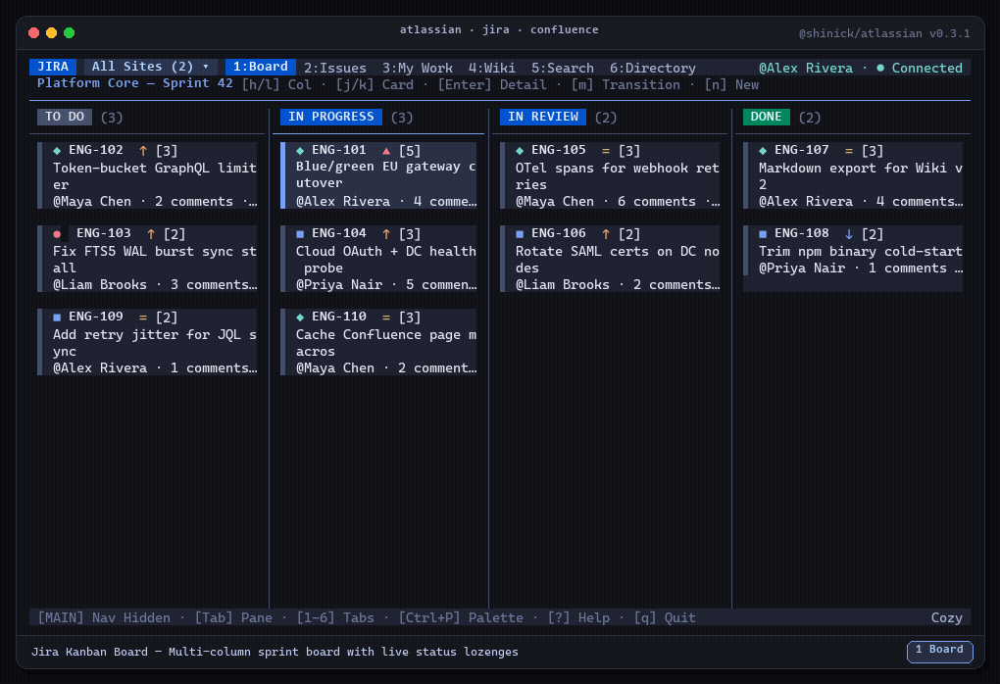

<div align="center">

# `@shinick/atlassian`

**Unified Atlassian Jira & Confluence native terminal client & AI agent toolkit — CLI · TUI · HTTP API · MCP.**

[](https://www.npmjs.com/package/@shinick/atlassian)
[](docs/NPM.md)
[](Cargo.toml)
[](package.json)

<br />



</div>

---

## Highlights

| Pillar | Capabilities |
| :--- | :--- |
| **Minimal-Chrome TUI** | Dual-persona binary (`atlassian` / `jira` / `confluence` / `conf`) with multi-column **Kanban Board**, **Issues & JQL Explorer**, **Confluence Space & Page Tree + TOC**, **Multi-Site Federation (`Ctrl+S`)** across Cloud OAuth 2.0 + Data Center PAT, **Link Extractor (`u`)**, **File Picker (`Ctrl+F`)** with `zoxide` jump, **Command Palette (`Ctrl+P`)**, and **Live Settings (`Ctrl+,`)** (5 palettes, Cozy/Compact density). |
| **High-Res Terminal Images** | Inline attachment previews for Jira issues & Confluence pages via **Kitty Graphics**, **iTerm2**, **Sixel**, and **24-bit Truecolor Half-Block (`▀`)** fallback (`v` HD modal & `--preview-images`). |
| **Local SQLite FTS5 + IPC Daemon** | Embedded SQLite WAL + FTS5 cache (`cache.db`) with instant offline unified search across Jira issues & Confluence pages (including `<3`-char CJK/Korean fallback), plus single-instance background sync IPC daemon (`jira daemon start`). |
| **4-in-1 Agent Interface** | Same binary powers the **Interactive TUI**, scriptable **`--json` CLI**, local **HTTP JSON API** (`jira serve`, `:8789`, Bearer auth), and **stdio MCP server** (`jira mcp`, **28 typed tools** with `confirm: true` delete guards). |

---

## Quick Start

```bash
# 1. Install globally (links `atlassian`, `jira`, `confluence`, `conf` native binaries)
npm i -g @shinick/atlassian

# 2. Authenticate — Atlassian Cloud (OAuth 2.0 or API Token) or Data Center (PAT)
jira login --url https://acme.atlassian.net --email you@acme.com --token "$ATLASSIAN_API_TOKEN"
# Or Data Center / Server:
jira login --url https://jira.acme.internal --confluence-url https://wiki.acme.internal --deployment datacenter --pat "$ATLASSIAN_PAT"
# Or Atlassian Cloud OAuth 2.0 (3LO) with multi-site discovery:
jira login --oauth --client-id "$ATLASSIAN_OAUTH_CLIENT_ID"

# 3. Launch the TUI (Jira Kanban or Confluence Wiki persona)
jira          # Jira Kanban Board & Issue Explorer
confluence    # Confluence Space Tree & Wiki Reader (alias: conf)
```

---

## Keybindings Cheat Sheet

| Key | Action | Context |
| :--- | :--- | :--- |
| `1`–`6` / `Ctrl+1`–`6` | Switch tabs: Board / Issues / My Work / Wiki / Search / Directory | Global |
| `Tab` / `Shift+Tab` | Cycle focus across Nav rail, Main canvas, and Detail/TOC drawer | Global |
| `Ctrl+B` | Toggle left navigation sidebar | Global |
| `h` `j` `k` `l` / Arrows | Navigate Kanban columns, cards, issue lists, and page trees | Board / Lists / Tree |
| `m` / `i` / `a` | Transition issue status / Assign to me / Pick assignee | Jira |
| `c` / `n` / `e` | Add comment / Create issue or child page / Edit (`Ctrl+E` `$EDITOR`) | Jira / Confluence |
| `g` / `Backspace` | Jump across linked `Jira <-> Confluence` refs / navigate back | Global |
| `Space` / `t` | Expand or collapse Confluence tree node / toggle TOC drawer | Confluence |
| `u` / `Ctrl+F` / `v` / `d` | Link Extractor / File Picker (`z` zoxide) / Image Preview / Download | Global |
| `Ctrl+S` | Multi-Site Switcher (`All Sites` federated view, Cloud + DC) | Global |
| `Ctrl+P` / `:` | Command Palette (fuzzy search every action) | Global |
| `Ctrl+,` / `?` / `q` | Live Settings / Keyboard Shortcuts Help / Quit | Global |

---

## CLI, HTTP API & MCP

### CLI (`--json` ready)

```bash
# Multi-site management & diagnostics
jira sites list --json
jira doctor

# Jira boards, JQL search, transitions & comments
jira boards --project ENG --json
jira issues --jql "project = ENG AND sprint in openSprints()" --json
jira view ENG-101 --preview-images
jira transition ENG-101 "In Review" --comment "Canary 50% green"
jira attach ENG-101 ./architecture.png

# Confluence spaces, pages & unified offline/remote search
conf spaces --json
conf pages ENG --json
conf view 40211 --preview-images
jira search "migration runbook" --json

# Background sync daemon & self-updater
jira daemon start
jira update --check
```

### Local HTTP JSON API (`jira serve`)

```bash
jira serve --bind 127.0.0.1 --port 8789 --token "$API_TOKEN"
curl -H "Authorization: Bearer $API_TOKEN" "http://127.0.0.1:8789/search?q=gateway"
```

Full endpoint catalog and OpenAPI schema: **[docs/API.md](docs/API.md)** · **[docs/openapi.yaml](docs/openapi.yaml)**.

### MCP Server (`jira mcp` — 28 Tools)

```json
{
  "mcpServers": {
    "atlassian": {
      "command": "jira",
      "args": ["mcp"]
    }
  }
}
```

Full tool catalog and argument schemas: **[docs/MCP.md](docs/MCP.md)** · npm packaging details: **[docs/NPM.md](docs/NPM.md)**.

---

## `@shinick` Enterprise Terminal Suite

| Package | Commands | Workspace | Interfaces |
| :--- | :--- | :--- | :--- |
| [`@shinick/teams`](https://www.npmjs.com/package/@shinick/teams) | `teams` | Microsoft Teams (Chats, Channels, Meetings & Threads) | TUI · CLI · HTTP · MCP |
| [`@shinick/outlook`](https://www.npmjs.com/package/@shinick/outlook) | `outlook`, `ol` | Microsoft Outlook (Mail, Calendar & Contacts) | TUI · CLI · HTTP · MCP |
| [`@shinick/onenote`](https://www.npmjs.com/package/@shinick/onenote) | `onenote`, `on` | Microsoft OneNote (Notebooks, Sections & Pages) | TUI · CLI · HTTP · MCP |
| [`@shinick/sharepoint`](https://www.npmjs.com/package/@shinick/sharepoint) | `sharepoint`, `sp` | Microsoft SharePoint & OneDrive (Sites, Libraries & Lists) | TUI · CLI · HTTP · MCP |
| **`@shinick/atlassian`** | `atlassian`, `jira`, `confluence`, `conf` | Atlassian Jira (Kanban, Sprints, JQL) & Confluence Wiki | TUI · CLI · HTTP · MCP |
| [`@shinick/notion`](https://www.npmjs.com/package/@shinick/notion) | `notion`, `nt` | Notion (Editorial Pages, Interactive Blocks & Databases) | TUI · CLI · HTTP · MCP |

---

> **Disclaimer:** Unofficial terminal client for Atlassian Jira & Confluence. Not affiliated with, endorsed by, or sponsored by Atlassian.
